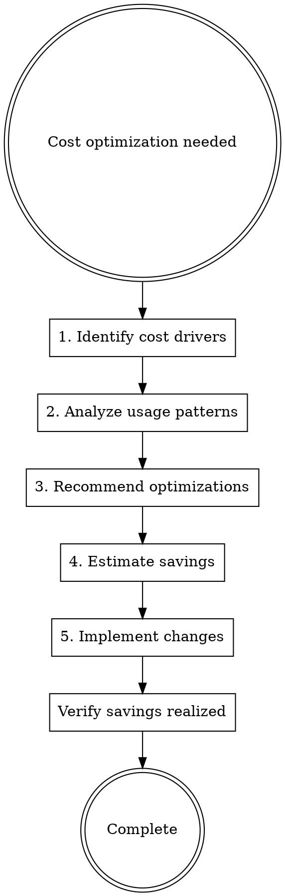

# AWS Cost Optimization

Expert guidance for analyzing, optimizing, and managing AWS costs through proven strategies including Reserved Instances, right-sizing, resource cleanup, and cost monitoring.

## When to Use

Use this skill when:

- Analyzing AWS cost trends and identifying major cost drivers
- Implementing cost optimization strategies to reduce cloud spend
- Setting up cost monitoring, budgets, and alerts
- Evaluating Reserved Instances, Savings Plans, or Spot Instances
- Right-sizing over-provisioned resources
- Cleaning up unused or idle resources
- Optimizing storage costs (S3, EBS, snapshots)
- Reducing data transfer costs
- Preparing for FinOps reviews or cost optimization audits
- User asks "how can I reduce my AWS bill?" or "why is AWS so expensive?"

## Core Principle

**Systematic cost analysis and continuous optimization ensure you pay only for what you need while maintaining performance and reliability.**

Cost optimization is not a one-time activity but an ongoing practice of understanding usage patterns, eliminating waste, and aligning resources with actual demand.

## The Cost Optimization Framework

**CRITICAL: You MUST follow the five-step methodology systematically. Skipping steps leads to missed savings opportunities and misaligned optimizations.**



**Red Flags - You're Skipping the Framework:**
- Making optimization recommendations before analyzing usage patterns
- Suggesting Reserved Instances without examining actual utilization
- Recommending service changes without understanding workload requirements
- Providing generic advice instead of account-specific analysis
- Skipping the savings estimation step

## Step 1: Identify Cost Drivers

### Use AWS Cost Explorer

**Key questions to answer:**
- What are the top 5 services by spend?
- Which accounts/projects are the highest spenders?
- What's the month-over-month cost trend?
- Are there any unexpected cost spikes?

### Cost Analysis Tools

| Tool | Purpose | When to Use |
|------|---------|-------------|
| **AWS Cost Explorer** | Visualize and analyze spending patterns | Daily/monthly cost reviews |
| **AWS Cost and Usage Reports** | Detailed billing data for analysis | Deep-dive investigations |
| **AWS Budgets** | Set spending limits and alerts | Proactive cost control |
| **AWS Cost Anomaly Detection** | Identify unusual spending patterns | Catch unexpected cost increases |
| **AWS Compute Optimizer** | Right-sizing recommendations | EC2, Lambda, EBS optimization |
| **AWS Trusted Advisor** | Best practice recommendations | Regular health checks |
| **Third-party tools** | CloudHealth, CloudCheckr, Spot.io | Advanced FinOps workflows |

### Cost Allocation Strategy

**Implement comprehensive tagging:**

```typescript
// CDK Example: Consistent tagging strategy
import * as cdk from 'aws-cdk-lib';

const commonTags = {
  Environment: 'production',
  Project: 'web-app',
  CostCenter: 'engineering',
  Owner: 'team-platform',
  Application: 'api-service',
};

// Apply tags to all resources in the stack
cdk.Tags.of(stack).add('Environment', commonTags.Environment);
cdk.Tags.of(stack).add('Project', commonTags.Project);
cdk.Tags.of(stack).add('CostCenter', commonTags.CostCenter);
cdk.Tags.of(stack).add('Owner', commonTags.Owner);
```

**Essential tags for cost allocation:**
- `Environment` (production, staging, dev)
- `Project` (project or product name)
- `CostCenter` (department or team)
- `Owner` (responsible team or person)
- `Application` (specific application or service)

## Step 2: Analyze Usage Patterns

### Compute Utilization Analysis

**EC2 Instances:**
```bash
# Use AWS CLI to analyze EC2 utilization
aws cloudwatch get-metric-statistics \
  --namespace AWS/EC2 \
  --metric-name CPUUtilization \
  --dimensions Name=InstanceId,Value=i-1234567890abcdef0 \
  --start-time 2024-01-01T00:00:00Z \
  --end-time 2024-01-31T23:59:59Z \
  --period 3600 \
  --statistics Average
```

**Key metrics to analyze:**
- **CPU Utilization**: < 40% average = over-provisioned
- **Memory Utilization**: < 40% average = over-provisioned
- **Network I/O**: Consistently low = potential for smaller instance
- **Disk I/O**: Low IOPS usage = EBS optimization opportunity

### Storage Utilization Analysis

**S3 Storage Classes:**
- Identify data access patterns (last accessed date)
- Determine appropriate storage tiers
- Calculate potential savings from lifecycle policies

**EBS Volumes:**
- Find unattached volumes (paying for unused storage)
- Identify volumes with low IOPS (gp2 → gp3 migration)
- Check snapshot retention policies

### Database Utilization

**RDS/Aurora:**
- CPU and connection utilization
- Read/write operation patterns
- Multi-AZ requirements
- Backup retention policies

**DynamoDB:**
- Provisioned vs actual throughput
- Read/write capacity utilization
- On-demand vs provisioned comparison

## Step 3: Service-Specific Optimization Strategies

### Compute: EC2 Optimization

#### 1. Right-Sizing

**Process:**
1. Analyze CloudWatch metrics (CPU, memory, network, disk)
2. Identify consistently under-utilized instances (< 40% avg utilization)
3. Use AWS Compute Optimizer recommendations
4. Test smaller instance types in non-production first

**Example findings:**
```
Instance: i-abc123 (m5.2xlarge)
- Average CPU: 15%
- Average Memory: 25%
- Recommendation: Downgrade to m5.large
- Monthly Savings: $200
```

#### 2. Reserved Instances (RI)

**When to use:**
- Steady-state workloads running 24/7
- Predictable capacity needs for 1-3 years
- Potential savings: 30-75% vs On-Demand

**RI Purchase Strategy:**
```
1. Analyze last 3-6 months of EC2 usage
2. Identify instances running consistently
3. Start with 1-year Standard RIs for stability
4. Use Convertible RIs if flexibility needed
5. Purchase incrementally, not all upfront
```

**RI Types:**
| Type | Discount | Flexibility | Use Case |
|------|----------|-------------|----------|
| **Standard** | Up to 75% | Low | Stable workloads, known instance types |
| **Convertible** | Up to 54% | High | Workloads that may need instance type changes |
| **Scheduled** | Up to 10% | Scheduled | Predictable recurring usage patterns |

#### 3. Savings Plans

**Compute Savings Plans:**
- Flexible across instance family, size, region
- Apply to EC2, Lambda, Fargate
- 1-year or 3-year commitment
- Savings: 30-70%

**EC2 Instance Savings Plans:**
- Tied to specific instance family in a region
- Higher discount than Compute Savings Plans
- Less flexibility but more savings

**Comparison:**
```
Scenario: $10,000/month On-Demand spend

Option 1: Reserved Instances (3-year Standard)
- Discount: 65%
- Monthly Cost: $3,500
- Annual Savings: $78,000

Option 2: Compute Savings Plans (1-year)
- Discount: 40%
- Monthly Cost: $6,000
- Annual Savings: $48,000
- Flexibility: High (can change instance types)
```

#### 4. Spot Instances

**When to use:**
- Fault-tolerant workloads
- Batch processing jobs
- CI/CD pipelines
- Containerized applications with auto-scaling
- Potential savings: 50-90% vs On-Demand

**Never use Spot for:**
- Databases (unless using spot-friendly patterns)
- Stateful applications without proper handling
- Critical production workloads without fallback

**Implementation example:**
```typescript
// CDK: Auto Scaling Group with Spot instances
import * as autoscaling from 'aws-cdk-lib/aws-autoscaling';
import * as ec2 from 'aws-cdk-lib/aws-ec2';

const asg = new autoscaling.AutoScalingGroup(this, 'ASG', {
  vpc,
  instanceType: ec2.InstanceType.of(ec2.InstanceClass.T3, ec2.InstanceSize.MEDIUM),
  machineImage: ec2.MachineImage.latestAmazonLinux2(),
  minCapacity: 2,
  maxCapacity: 10,
  spotPrice: '0.05', // Max price per hour
});

// Mix of On-Demand and Spot
const mixedInstancesPolicy = {
  instancesDistribution: {
    onDemandBaseCapacity: 2, // Minimum On-Demand instances
    onDemandPercentageAboveBaseCapacity: 20, // 20% On-Demand, 80% Spot
    spotAllocationStrategy: 'lowest-price',
  },
};
```

#### 5. Stop/Start Schedules

**Non-production environments:**
```python
# Lambda function to stop instances on schedule
import boto3
from datetime import datetime

def lambda_handler(event, context):
    ec2 = boto3.client('ec2')

    # Stop dev/test instances outside business hours
    # Monday-Friday: 9 AM - 6 PM
    current_time = datetime.now()

    if current_time.weekday() >= 5:  # Weekend
        # Stop all dev instances
        filters = [{'Name': 'tag:Environment', 'Values': ['dev', 'test']}]
        instances = ec2.describe_instances(Filters=filters)

        for reservation in instances['Reservations']:
            for instance in reservation['Instances']:
                if instance['State']['Name'] == 'running':
                    ec2.stop_instances(InstanceIds=[instance['InstanceId']])
                    print(f"Stopped {instance['InstanceId']}")
```

**Potential savings:**
- Run dev/test 8 hours/day, 5 days/week instead of 24/7
- **Savings: 76%** on non-production compute costs

### Storage: S3 Optimization

#### 1. Storage Class Selection

| Storage Class | Use Case | Cost (relative) | Retrieval Cost |
|---------------|----------|-----------------|----------------|
| **S3 Standard** | Frequently accessed data | 100% | None |
| **S3 Intelligent-Tiering** | Unknown or changing access patterns | Auto-optimized | Small monitoring fee |
| **S3 Standard-IA** | Infrequent access (< 1x/month) | 50% | Per GB |
| **S3 One Zone-IA** | Infrequent, recreatable data | 40% | Per GB |
| **S3 Glacier Instant Retrieval** | Archive, instant access | 35% | Per GB |
| **S3 Glacier Flexible Retrieval** | Archive, minutes-hours retrieval | 20% | Per GB |
| **S3 Glacier Deep Archive** | Long-term archive, 12+ hours retrieval | 10% | Per GB |

#### 2. Lifecycle Policies

**Example policy:**
```typescript
// CDK: S3 lifecycle rules
import * as s3 from 'aws-cdk-lib/aws-s3';

const bucket = new s3.Bucket(this, 'DataBucket', {
  lifecycleRules: [
    {
      id: 'TransitionToIA',
      enabled: true,
      transitions: [
        {
          storageClass: s3.StorageClass.INFREQUENT_ACCESS,
          transitionAfter: cdk.Duration.days(30),
        },
        {
          storageClass: s3.StorageClass.GLACIER,
          transitionAfter: cdk.Duration.days(90),
        },
        {
          storageClass: s3.StorageClass.DEEP_ARCHIVE,
          transitionAfter: cdk.Duration.days(365),
        },
      ],
    },
    {
      id: 'DeleteOldVersions',
      enabled: true,
      noncurrentVersionExpiration: cdk.Duration.days(30),
    },
    {
      id: 'CleanupIncompleteUploads',
      enabled: true,
      abortIncompleteMultipartUploadAfter: cdk.Duration.days(7),
    },
  ],
});
```

**Typical savings:**
- 30 days → Standard-IA: **46% savings**
- 90 days → Glacier: **80% savings**
- 365 days → Deep Archive: **90% savings**

#### 3. S3 Intelligent-Tiering

**When to use:**
- Unpredictable access patterns
- Data with varying access frequency
- Want automatic optimization without manual policies

**How it works:**
1. Monitors access patterns
2. Automatically moves data between tiers:
   - Frequent Access (< 30 days since last access)
   - Infrequent Access (30-90 days)
   - Archive Instant Access (90-180 days)
   - Archive Access (180+ days)
   - Deep Archive Access (180+ days, optional)

**Cost:** Small monthly monitoring fee ($0.0025 per 1,000 objects)

#### 4. Delete Unnecessary Data

**Common waste sources:**
```bash
# Find incomplete multipart uploads
aws s3api list-multipart-uploads --bucket my-bucket

# Find old versions (if versioning enabled)
aws s3api list-object-versions --bucket my-bucket

# Analyze bucket contents by storage class
aws s3api list-objects-v2 --bucket my-bucket \
  --query "Contents[?StorageClass=='STANDARD'].{Key:Key,Size:Size}" \
  --output table
```

### Storage: EBS Optimization

#### 1. Delete Unattached Volumes

**Find unattached volumes:**
```bash
aws ec2 describe-volumes \
  --filters Name=status,Values=available \
  --query "Volumes[].{ID:VolumeId,Size:Size,Type:VolumeType}" \
  --output table
```

**Typical savings:**
- Average unattached volume cost: $10-50/month each
- Large environments can have 50-100+ unattached volumes
- **Potential savings: $500-5,000/month**

#### 2. Upgrade gp2 to gp3

**gp3 advantages:**
- 20% cheaper than gp2 for same storage
- Baseline performance: 3,000 IOPS, 125 MB/s throughput
- Can provision additional IOPS/throughput independently

**Cost comparison (1TB volume):**
```
gp2: $100/month
gp3: $80/month (same performance)
Savings: $20/month per 1TB volume
```

**Migration:**
```bash
# Modify volume type from gp2 to gp3
aws ec2 modify-volume \
  --volume-id vol-1234567890abcdef0 \
  --volume-type gp3
```

#### 3. Snapshot Management

**Cleanup old snapshots:**
```python
# Delete snapshots older than retention period
import boto3
from datetime import datetime, timedelta

ec2 = boto3.client('ec2')
retention_days = 30

snapshots = ec2.describe_snapshots(OwnerIds=['self'])['Snapshots']

for snapshot in snapshots:
    start_time = snapshot['StartTime'].replace(tzinfo=None)
    age = (datetime.now() - start_time).days

    if age > retention_days:
        ec2.delete_snapshot(SnapshotId=snapshot['SnapshotId'])
        print(f"Deleted snapshot {snapshot['SnapshotId']} ({age} days old)")
```

### Database: RDS Optimization

#### 1. Right-Sizing

**Analyze CloudWatch metrics:**
- CPU utilization < 40% → consider smaller instance
- Free memory consistently high → reduce memory
- IOPS usage → adjust storage type

#### 2. Reserved Instances

**RDS RI Strategy:**
- 1-year or 3-year commitment
- Savings: 30-69% vs On-Demand
- Start with production databases
- Use Convertible RIs for flexibility

#### 3. Stop Dev/Test Databases

**Automate start/stop:**
```python
# Lambda to stop RDS instances on schedule
import boto3

def lambda_handler(event, context):
    rds = boto3.client('rds')

    # Stop dev databases outside business hours
    instances = rds.describe_db_instances()

    for db in instances['DBInstances']:
        tags = rds.list_tags_for_resource(
            ResourceName=db['DBInstanceArn']
        )['TagList']

        env_tag = next((t['Value'] for t in tags if t['Key'] == 'Environment'), None)

        if env_tag in ['dev', 'test'] and db['DBInstanceStatus'] == 'available':
            rds.stop_db_instance(DBInstanceIdentifier=db['DBInstanceIdentifier'])
            print(f"Stopped {db['DBInstanceIdentifier']}")
```

#### 4. Snapshot Cleanup

**Automated snapshot retention:**
```typescript
// CDK: RDS with snapshot retention
import * as rds from 'aws-cdk-lib/aws-rds';

const database = new rds.DatabaseInstance(this, 'Database', {
  engine: rds.DatabaseInstanceEngine.postgres({
    version: rds.PostgresEngineVersion.VER_15,
  }),
  backupRetention: cdk.Duration.days(7), // Keep 7 days of automated backups
  deleteAutomatedBackups: true, // Delete backups when instance is deleted
  // ...
});
```

### Database: DynamoDB Optimization

#### 1. On-Demand vs Provisioned

**When to use On-Demand:**
- Unpredictable traffic patterns
- New applications with unknown load
- Spiky traffic
- Pay only for what you use

**When to use Provisioned:**
- Predictable traffic
- Consistent baseline load
- Can save 30-60% vs On-Demand with proper capacity planning

**Cost comparison:**
```
Scenario: 10M read requests/day, 1M write requests/day

On-Demand:
- Read: $1.25 per million = $12.50
- Write: $6.25 per million = $6.25
- Total: $18.75/day = $562.50/month

Provisioned (with Auto Scaling):
- 5 RCU, 1 WCU average
- Cost: ~$250/month
- Savings: $312.50/month (55%)
```

#### 2. Auto Scaling

**Configure Auto Scaling for provisioned capacity:**
```typescript
// CDK: DynamoDB with Auto Scaling
import * as dynamodb from 'aws-cdk-lib/aws-dynamodb';

const table = new dynamodb.Table(this, 'Table', {
  partitionKey: { name: 'id', type: dynamodb.AttributeType.STRING },
  billingMode: dynamodb.BillingMode.PROVISIONED,
  readCapacity: 5,
  writeCapacity: 5,
});

// Enable Auto Scaling
const readScaling = table.autoScaleReadCapacity({
  minCapacity: 5,
  maxCapacity: 100,
});

readScaling.scaleOnUtilization({
  targetUtilizationPercent: 70,
});

const writeScaling = table.autoScaleWriteCapacity({
  minCapacity: 5,
  maxCapacity: 100,
});

writeScaling.scaleOnUtilization({
  targetUtilizationPercent: 70,
});
```

### Compute: Lambda Optimization

#### 1. Memory Optimization

**Strategy:**
- Lambda charges for memory × duration
- More memory = faster execution (up to a point)
- Find optimal memory setting using AWS Lambda Power Tuning

**Example:**
```
Function with 512MB: 2000ms execution = 1024 MB-seconds
Function with 1024MB: 1200ms execution = 1228.8 MB-seconds

But with better CPU:
Function with 1024MB: 800ms execution = 819.2 MB-seconds
Savings: 20% despite doubling memory
```

#### 2. Reduce Cold Starts

**Techniques:**
- Use Provisioned Concurrency for latency-sensitive functions
- Minimize dependencies and package size
- Use Lambda SnapStart (for Java)
- Keep functions warm with scheduled invocations (last resort)

#### 3. Monitor Invocation Patterns

**Cost optimization:**
```bash
# Analyze Lambda invocations
aws cloudwatch get-metric-statistics \
  --namespace AWS/Lambda \
  --metric-name Invocations \
  --dimensions Name=FunctionName,Value=my-function \
  --start-time 2024-01-01T00:00:00Z \
  --end-time 2024-01-31T23:59:59Z \
  --period 86400 \
  --statistics Sum
```

**Look for:**
- Unnecessary invocations (polling loops)
- Retry storms (fix error handling)
- Inefficient batch sizes (process more per invocation)

### Monitoring: CloudWatch Optimization

#### 1. Log Retention Policies

**Default retention:** Logs never expire (growing costs)

**Best practice:**
```bash
# Set log retention to 30 days for dev, 90 days for prod
aws logs put-retention-policy \
  --log-group-name /aws/lambda/my-function \
  --retention-in-days 30
```

**Typical savings:**
- Reduce retention from indefinite to 30 days
- **Savings: 70-90%** on log storage costs

#### 2. Delete Unused Log Groups

**Find empty or unused log groups:**
```python
import boto3

logs = boto3.client('logs')

log_groups = logs.describe_log_groups()['logGroups']

for group in log_groups:
    # Check if log group has recent logs
    streams = logs.describe_log_streams(
        logGroupName=group['logGroupName'],
        orderBy='LastEventTime',
        descending=True,
        limit=1
    )

    if not streams['logStreams']:
        # No streams, safe to delete
        logs.delete_log_group(logGroupName=group['logGroupName'])
        print(f"Deleted empty log group: {group['logGroupName']}")
```

### Networking: Data Transfer Optimization

#### 1. Use CloudFront

**Benefits:**
- Reduce data transfer from origin
- Cache at edge locations
- Cheaper egress pricing than direct S3/EC2

**Cost comparison (1TB egress):**
```
Direct from EC2/S3: $90
Via CloudFront: $85 (first 10TB tier)
Savings: 5-15% + performance benefits
```

#### 2. VPC Endpoints

**Save on NAT Gateway costs:**
```typescript
// CDK: VPC endpoint for S3
import * as ec2 from 'aws-cdk-lib/aws-ec2';

const vpc = new ec2.Vpc(this, 'VPC', {
  // ...
});

// S3 Gateway Endpoint (free)
vpc.addGatewayEndpoint('S3Endpoint', {
  service: ec2.GatewayVpcEndpointAwsService.S3,
});

// DynamoDB Gateway Endpoint (free)
vpc.addGatewayEndpoint('DynamoEndpoint', {
  service: ec2.GatewayVpcEndpointAwsService.DYNAMODB,
});
```

**Savings:**
- NAT Gateway: $0.045/GB processed
- VPC Endpoint (Gateway): $0/GB (free for S3/DynamoDB)
- **Potential savings: 100%** on data transfer to S3/DynamoDB

#### 3. Same-Region Architecture

**Cross-region data transfer costs:**
- Same region: $0.01/GB (or free within same AZ)
- Cross-region: $0.02/GB
- Avoid cross-region unless required for HA/DR

## Step 4: Cost Monitoring & Governance

### Budget Setup

**AWS Budgets configuration:**
```typescript
// CDK: Monthly budget with alerts
import * as budgets from 'aws-cdk-lib/aws-budgets';

new budgets.CfnBudget(this, 'MonthlyBudget', {
  budget: {
    budgetName: 'monthly-aws-budget',
    budgetType: 'COST',
    timeUnit: 'MONTHLY',
    budgetLimit: {
      amount: 5000,
      unit: 'USD',
    },
    costFilters: {
      // Optional: filter by service, tag, etc.
    },
  },
  notificationsWithSubscribers: [
    {
      notification: {
        notificationType: 'ACTUAL',
        comparisonOperator: 'GREATER_THAN',
        threshold: 80, // Alert at 80%
        thresholdType: 'PERCENTAGE',
      },
      subscribers: [
        {
          subscriptionType: 'EMAIL',
          address: 'finops-team@example.com',
        },
      ],
    },
    {
      notification: {
        notificationType: 'FORECASTED',
        comparisonOperator: 'GREATER_THAN',
        threshold: 100, // Forecast alert at 100%
        thresholdType: 'PERCENTAGE',
      },
      subscribers: [
        {
          subscriptionType: 'EMAIL',
          address: 'finops-team@example.com',
        },
      ],
    },
  ],
});
```

### Cost Anomaly Detection

**Enable automatic anomaly detection:**
```bash
# Create cost anomaly monitor
aws ce create-anomaly-monitor \
  --anomaly-monitor Name=AllServicesMonitor,MonitorType=DIMENSIONAL \
  --monitor-dimension=SERVICE

# Create anomaly subscription for alerts
aws ce create-anomaly-subscription \
  --anomaly-subscription file://subscription.json
```

**subscription.json:**
```json
{
  "SubscriptionName": "DailyCostAnomalies",
  "Threshold": 100.0,
  "Frequency": "DAILY",
  "MonitorArnList": ["arn:aws:ce::123456789012:anomalymonitor/12345678-1234-1234-1234-123456789012"],
  "Subscribers": [
    {
      "Type": "EMAIL",
      "Address": "finops-team@example.com"
    }
  ]
}
```

### Cost Allocation Tags

**Tag enforcement policy:**
```typescript
// CDK: Require tags on all resources
import * as cdk from 'aws-cdk-lib';

class TaggedStack extends cdk.Stack {
  constructor(scope: cdk.App, id: string, props?: cdk.StackProps) {
    super(scope, id, props);

    // Enforce required tags
    const requiredTags = {
      Environment: process.env.ENVIRONMENT || 'dev',
      Project: 'my-project',
      CostCenter: 'engineering',
      Owner: 'team-platform',
    };

    Object.entries(requiredTags).forEach(([key, value]) => {
      cdk.Tags.of(this).add(key, value);
    });
  }
}
```

**Tag governance with AWS Config:**
```json
{
  "ConfigRuleName": "required-tags",
  "Source": {
    "Owner": "AWS",
    "SourceIdentifier": "REQUIRED_TAGS"
  },
  "InputParameters": {
    "tag1Key": "Environment",
    "tag2Key": "Project",
    "tag3Key": "CostCenter"
  }
}
```

## Step 5: Implementation Checklist

Use this checklist to systematically implement cost optimizations:

### Compute Optimization
- [ ] Analyze EC2 instance utilization (CloudWatch metrics)
- [ ] Right-size under-utilized instances (< 40% CPU/memory)
- [ ] Purchase Reserved Instances or Savings Plans for stable workloads
- [ ] Implement Spot Instances for fault-tolerant workloads
- [ ] Set up stop/start schedules for dev/test environments
- [ ] Review Lambda memory settings and optimize
- [ ] Enable Lambda Provisioned Concurrency only when needed
- [ ] Terminate unused or idle EC2 instances

### Storage Optimization
- [ ] Implement S3 lifecycle policies to transition to cheaper tiers
- [ ] Enable S3 Intelligent-Tiering for unknown access patterns
- [ ] Delete incomplete multipart uploads
- [ ] Delete old S3 object versions if versioning enabled
- [ ] Find and delete unattached EBS volumes
- [ ] Upgrade gp2 volumes to gp3 (20% savings)
- [ ] Clean up old EBS snapshots (> retention period)
- [ ] Review EBS snapshot retention policies

### Database Optimization
- [ ] Right-size RDS instances based on CloudWatch metrics
- [ ] Purchase RDS Reserved Instances for production databases
- [ ] Stop dev/test RDS instances outside business hours
- [ ] Clean up old RDS snapshots
- [ ] Evaluate DynamoDB On-Demand vs Provisioned capacity
- [ ] Enable DynamoDB Auto Scaling for provisioned tables
- [ ] Review DynamoDB read/write capacity utilization

### Networking Optimization
- [ ] Use CloudFront for content delivery (reduce egress costs)
- [ ] Implement VPC endpoints for S3/DynamoDB (eliminate NAT costs)
- [ ] Consolidate resources in same region/AZ where possible
- [ ] Review data transfer patterns and optimize
- [ ] Consider AWS PrivateLink for service-to-service communication

### Monitoring & Governance
- [ ] Apply cost allocation tags consistently across all resources
- [ ] Enable AWS Cost Explorer and review monthly
- [ ] Set up AWS Budgets with alerts (80% and 100% thresholds)
- [ ] Enable AWS Cost Anomaly Detection
- [ ] Configure CloudWatch log retention policies (30-90 days)
- [ ] Delete unused CloudWatch log groups
- [ ] Schedule weekly cost reviews with team
- [ ] Document cost optimization wins and share with organization

## Review Cadence

**Weekly:**
- Check AWS Budgets for alerts
- Review Cost Anomaly Detection findings
- Verify stop/start schedules are working

**Monthly:**
- Deep dive Cost Explorer analysis
- Review top 10 cost drivers
- Analyze month-over-month trends
- Identify new optimization opportunities

**Quarterly:**
- Review Reserved Instance and Savings Plan utilization
- Evaluate new AWS services for cost optimization
- Conduct comprehensive cost optimization audit
- Update cost allocation tags strategy
- Review and adjust budgets based on trends

## Common Anti-Patterns

| Anti-Pattern | Issue | Better Approach |
|--------------|-------|-----------------|
| **No tagging strategy** | Can't allocate costs to teams/projects | Implement comprehensive tagging, enforce with policies |
| **No budgets or alerts** | Surprise bills | Set up AWS Budgets with multiple thresholds |
| **Always On-Demand** | Paying 3x more than necessary | Use Reserved Instances/Savings Plans for stable workloads |
| **Over-provisioning** | Paying for unused capacity | Right-size based on actual utilization metrics |
| **No lifecycle policies** | Paying premium storage for cold data | Implement S3 lifecycle policies to cheaper tiers |
| **Unattached volumes** | Paying for unused storage | Automate detection and deletion of unattached EBS |
| **Dev/test running 24/7** | 3x cost for non-production | Stop resources outside business hours |
| **Manual optimization** | Time-consuming, error-prone | Automate with Lambda, Systems Manager, AWS Backup |
| **No cost visibility** | Can't identify waste | Enable Cost Explorer, Cost and Usage Reports |

## Cost Optimization Prioritization

Use this matrix to prioritize optimization efforts:

| Priority | Savings Potential | Effort | Examples |
|----------|------------------|--------|----------|
| **High** | High savings, Low effort | Low | Delete unattached EBS volumes, stop unused instances |
| **High** | High savings, Medium effort | Medium | Purchase Reserved Instances, implement S3 lifecycle policies |
| **Medium** | Medium savings, Low effort | Low | CloudWatch log retention, right-size Lambda memory |
| **Medium** | High savings, High effort | High | Migrate to Spot Instances, re-architect for serverless |
| **Low** | Low savings, Any effort | Any | Micro-optimizations, minor instance type changes |

**Start with High Priority first** - quick wins that demonstrate value and build momentum.

## Real-World Example

**Scenario:** SaaS application with high AWS costs

**Initial State:**
- Monthly AWS spend: $50,000
- No Reserved Instances or Savings Plans
- Many unattached EBS volumes
- S3 data all in Standard storage class
- Dev/test environments running 24/7
- No cost allocation tags
- No budgets or alerts

**Cost Analysis (Step 1):**
- EC2: $25,000 (50%)
- S3: $8,000 (16%)
- RDS: $7,000 (14%)
- Data Transfer: $5,000 (10%)
- Other: $5,000 (10%)

**Optimizations Implemented (Steps 2-3):**

1. **EC2 Optimization:**
   - Right-sized 30% of instances: **-$3,000/month**
   - Purchased 1-year Compute Savings Plan (50% coverage): **-$6,250/month**
   - Implemented stop/start for dev/test (76% reduction): **-$4,500/month**
   - Terminated 10 unused instances: **-$1,500/month**

2. **S3 Optimization:**
   - Implemented lifecycle policies (30d → IA, 90d → Glacier): **-$3,200/month**
   - Deleted incomplete multipart uploads: **-$400/month**
   - Enabled Intelligent-Tiering for unpredictable data: **-$800/month**

3. **RDS Optimization:**
   - Right-sized 2 over-provisioned instances: **-$1,200/month**
   - Purchased 1-year RDS RI for production: **-$1,750/month**
   - Stop/start dev databases: **-$1,400/month**

4. **EBS Optimization:**
   - Deleted 50 unattached volumes: **-$1,000/month**
   - Migrated gp2 to gp3: **-$800/month**
   - Cleaned up old snapshots: **-$300/month**

5. **Networking:**
   - Implemented S3 VPC endpoint: **-$1,200/month**
   - CloudFront for static assets: **-$800/month**

6. **Governance:**
   - Implemented tagging strategy
   - Set up budgets and alerts
   - Enabled Cost Anomaly Detection

**Results:**
- **Total Monthly Savings: $27,100**
- **Annual Savings: $325,200**
- **New Monthly Cost: $22,900**
- **Cost Reduction: 54%**

**Ongoing Optimization:**
- Weekly cost reviews catch anomalies early
- Monthly analysis identifies new opportunities
- Quarterly RI/SP utilization reviews
- Continuous right-sizing based on CloudWatch data

## Common Mistakes When Using This Skill

| Mistake | Why It's Wrong | Correct Approach |
|---------|----------------|------------------|
| "We'll optimize later" | Costs compound quickly, harder to change later | Start cost optimization from day one |
| Optimizing without analyzing usage | May hurt performance or availability | Always analyze usage patterns first, then optimize |
| Buying 3-year RIs without testing | Locked into potentially wrong capacity | Start with 1-year, or use Convertible RIs |
| No cost allocation tags | Can't track who's spending what | Implement comprehensive tagging from start |
| Only optimizing once | Costs drift as usage changes | Make cost optimization ongoing practice |
| Ignoring small costs | Small costs add up to significant waste | Systematically address all waste, even small items |
| Manual optimization only | Time-consuming, doesn't scale | Automate detection, remediation, and monitoring |

## AWS Cost Optimization Tools Reference

### AWS Native Tools
- **AWS Cost Explorer**: Visualize spending patterns, analyze trends
- **AWS Cost and Usage Reports**: Detailed billing data for analysis
- **AWS Budgets**: Set spending limits and alerts
- **AWS Cost Anomaly Detection**: Identify unusual spending
- **AWS Compute Optimizer**: Right-sizing recommendations for EC2, Lambda, EBS
- **AWS Trusted Advisor**: Best practice recommendations (requires Business/Enterprise support)
- **AWS Pricing Calculator**: Estimate costs before deployment

### Third-Party Tools
- **CloudHealth by VMware**: Multi-cloud cost management and governance
- **CloudCheckr**: Cost optimization and compliance
- **Spot.io**: Automated cloud cost optimization
- **Kubecost**: Kubernetes cost monitoring and optimization
- **Infracost**: Infrastructure as code cost estimation

### CLI Commands Cheat Sheet

```bash
# Cost Explorer: Get monthly costs
aws ce get-cost-and-usage \
  --time-period Start=2024-01-01,End=2024-01-31 \
  --granularity MONTHLY \
  --metrics BlendedCost

# Find unattached EBS volumes
aws ec2 describe-volumes \
  --filters Name=status,Values=available \
  --query "Volumes[*].{ID:VolumeId,Size:Size,Type:VolumeType,Created:CreateTime}"

# Find unattached Elastic IPs
aws ec2 describe-addresses \
  --query "Addresses[?AssociationId==null].{IP:PublicIp,AllocationId:AllocationId}"

# List unused NAT Gateways (check metrics separately)
aws ec2 describe-nat-gateways \
  --filter Name=state,Values=available

# Find old snapshots (> 90 days)
aws ec2 describe-snapshots \
  --owner-ids self \
  --query "Snapshots[?StartTime<='$(date -u -d '90 days ago' '+%Y-%m-%d')'].{ID:SnapshotId,Created:StartTime,Size:VolumeSize}"

# Analyze S3 storage by class
aws s3api list-buckets --query "Buckets[].Name" --output text | \
  xargs -I {} aws s3api list-objects-v2 --bucket {} \
  --query "Contents[].{StorageClass:StorageClass}" --output text | \
  sort | uniq -c

# Get Lambda function costs (via CloudWatch metrics)
aws cloudwatch get-metric-statistics \
  --namespace AWS/Lambda \
  --metric-name Duration \
  --dimensions Name=FunctionName,Value=my-function \
  --start-time $(date -u -d '30 days ago' '+%Y-%m-%dT%H:%M:%S') \
  --end-time $(date -u '+%Y-%m-%dT%H:%M:%S') \
  --period 2592000 \
  --statistics Sum
```

## Resources

- [AWS Cost Management](https://aws.amazon.com/aws-cost-management/)
- [AWS Cost Optimization Documentation](https://docs.aws.amazon.com/cost-management/)
- [AWS Well-Architected Framework - Cost Optimization Pillar](https://docs.aws.amazon.com/wellarchitected/latest/cost-optimization-pillar/welcome.html)
- [AWS Pricing](https://aws.amazon.com/pricing/)
- [AWS Compute Optimizer](https://aws.amazon.com/compute-optimizer/)
- [AWS Trusted Advisor](https://aws.amazon.com/premiumsupport/technology/trusted-advisor/)
- [AWS Cost Optimization Blog](https://aws.amazon.com/blogs/aws-cloud-financial-management/)

## Using This Skill

When performing cost optimization:

1. **Start with data** - analyze actual spending patterns before recommending changes
2. **Prioritize by impact** - focus on high-savings, low-effort opportunities first
3. **Consider trade-offs** - balance cost vs performance, availability, and complexity
4. **Be specific** - provide exact AWS service names, CLI commands, and code examples
5. **Estimate savings** - quantify expected savings for each recommendation
6. **Implement incrementally** - test changes in dev/test before production
7. **Monitor results** - verify savings are realized after implementation
8. **Automate** - use Lambda, Systems Manager, and AWS Backup for routine tasks
9. **Establish governance** - implement tagging, budgets, and regular reviews
10. **Make it ongoing** - cost optimization is continuous, not one-time

**Remember:** The goal is not just to reduce costs, but to eliminate waste while maintaining or improving performance, reliability, and security.

**Critical:** Always analyze usage patterns before making changes. The most expensive mistake is optimizing based on assumptions rather than data.
